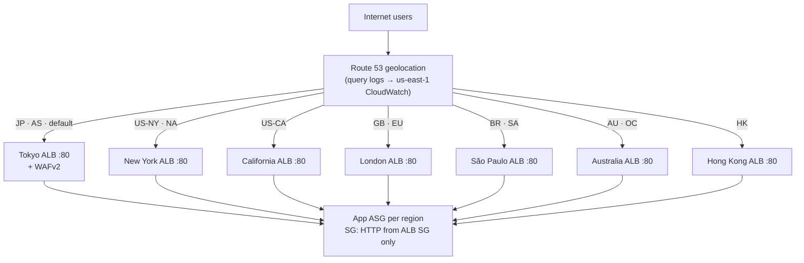
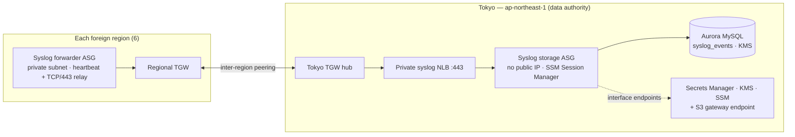
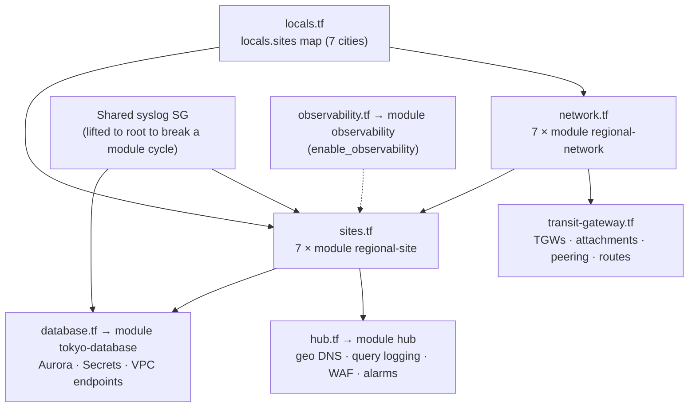
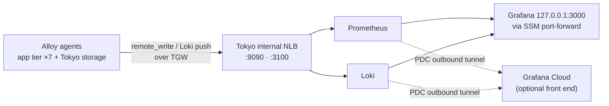

# Architecture

Diagrams for Zion Armageddon v102. The README carries the design narrative and the layer table. This page is the visual reference.

## Public path — geolocation DNS to regional apps

Only port 80 is public. `test/verify.sh` asserts that HTTPS :443 on Tokyo is **blocked**.

## Private path — syslog over the Transit Gateway mesh

**Residency rule:** foreign regions forward and never store. Aurora and durable syslog rows exist only in Tokyo private subnets.

## Terraform module structure

## Optional observability (PLG)

Metrics and logs stay in Japan. Grafana Cloud receives only the query results a user opens.
